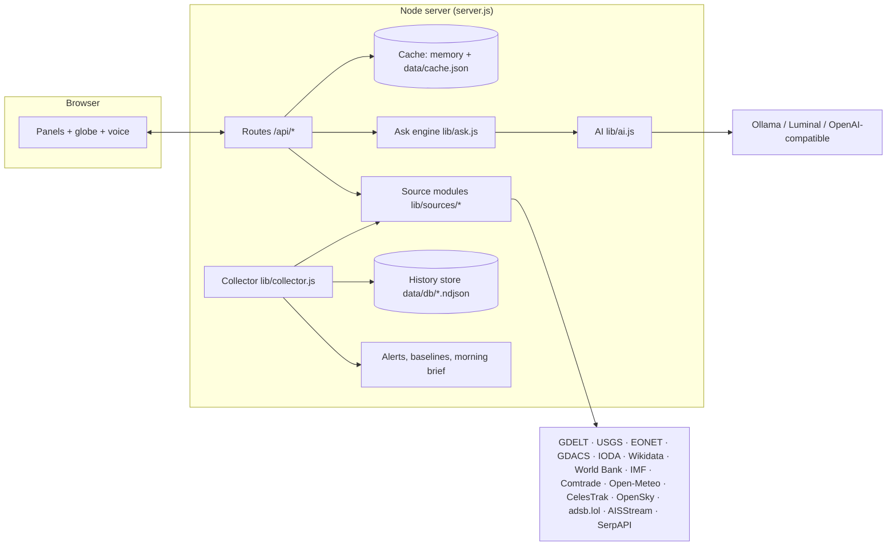

# Global Watch

**A country-intelligence board.** A rotating 3D globe is the menu. Click any country, or just ask out loud, and every panel turns into a live briefing on it: news, economy, markets, trade, government, travel risk, hazards, unrest, internet outages, aircraft, ships and satellites. A background collector keeps history, learns what's normal, and raises alerts when something isn't.

It runs on your own computer as a small Node.js server plus a browser front end. API keys stay in a local `.env` file and never reach the browser.

> **Status:** active development. Everything in the table below is built and runs locally. Live-data parsers for the newer sources are being checked against real responses. See [Roadmap](#roadmap).

---

## What it does

| Area | What you get | Source |
|---|---|---|
| **Globe** | Drag, zoom, click a country. Day/night shading with sun and moon positions, time-zone bands, satellites, aircraft and ships as live dots, hazard and unrest markers, trade arcs, colour-by-measure modes. | Natural Earth (world-atlas), computed astronomy |
| **News** | Live headlines in English or the country's own media. Stories merged across outlets, "new to you" ranking, story threads over days, tone trend, domestic vs foreign and state-media flags, translation, keyword alerts, AI digest of only what's new. | GDELT 2.0 (free); Google News via SerpAPI optional |
| **Finance** | Economy history and IMF forecasts, live stock viewer (any ticker, 1D to max), regional indexes, movers, watchlist, exchange rate with 1-year chart and volatility, country risk score. | World Bank, IMF, Google Finance (SerpAPI), ExchangeRate-API, Frankfurter (ECB) |
| **Trade** | Top export and import partners, top products, drawn as arcs on the globe. | UN Comtrade |
| **Government** | Head of state and government with photos, system, legislature, memberships, recent and upcoming elections. | Wikidata |
| **Stability** | US and UK travel advisories, internet outage alerts and signal charts. | US State Dept, UK FCDO, IODA (Georgia Tech) |
| **Hazards and unrest** | Earthquakes, wildfires, storms, volcanoes, UN disaster alerts, protest and conflict coverage with map points and a 14-day trend. | USGS, NASA EONET, GDACS, GDELT |
| **Tracking** | Aircraft registered to a country (anywhere) or in its airspace, military flagged; circling/holding detection; emergency squawks worldwide; 24 h replay. Ships flagged to a country or near its coast; ships that go dark. | OpenSky, adsb.lol, AISStream |
| **Space** | Satellites a country operates, by group (navigation, constellations, government), live positions on the globe. | CelesTrak (TLE + SATCAT), satellite.js |
| **Travel** | Google Flights fares and price insight, Google Hotels, things to do from Google Maps, AI day plan from real places, visa rules for your passport, best months to visit, 7-day weather. | SerpAPI, Passport Index dataset, Open-Meteo |
| **Ask anything / voice** | Press **P**, speak, and it answers out loud. Your question is routed to the right countries and panels, their live data is gathered with numbered sources, and the model answers with citations. | Your AI model (local Ollama, Luminal, or any OpenAI-compatible API) |
| **Alerts and briefs** | Learns hourly baselines (military flights, news volume) and flags anomalies; big quakes, red/orange disaster alerts, internet shutdowns, advisory changes, emergency squawks, your keyword rules; a morning brief for your watchlist. | All of the above |

---

## Quick start (Windows, macOS, Linux)

1. Install **Node.js 22 or newer** from <https://nodejs.org>. Node 18 works for everything except ships.
2. Clone this repo.
3. Copy `.env.example` to `.env` and add your keys (see below). Everything works without keys in **sample mode**.
4. Start it:
   - Windows: double-click **`start.bat`**. On first run it creates `.env` and opens it in Notepad.
   - Anywhere: `node server.js`
5. Open <http://localhost:8787>.

There's no `npm install`: the server has zero dependencies, and the front-end libraries are bundled in `public/vendor/`.

### Keys (`.env`)

| Setting | Needed for | Cost |
|---|---|---|
| `SERPAPI_KEY` | Stock viewer, flights, hotels, places (and optional Google News) | Free tier ≈ 100–250 searches/month |
| `AISSTREAM_KEY` | Live ships | Free (sign in at aisstream.io with GitHub) |
| `OPENSKY_CLIENT_ID` / `OPENSKY_CLIENT_SECRET` | More frequent aircraft snapshots | Free account |
| `AI_BASE_URL`, `AI_API_KEY`, `AI_MODEL` | Any OpenAI-compatible model (e.g. DeepSeek) | Depends on provider |
| `LUMINAL_API_KEY` (+ `LUMINAL_TEXT_BASE_URL`, `LUMINAL_TEXT_MODEL`) | Luminal Text API | Paid |
| `OLLAMA_MODEL` | Pick a specific local model (otherwise the best one installed is chosen) | Free |
| `APP_PASSWORD`, `HOST=0.0.0.0` | Hosting it publicly | – |
| `MOCK=1` | Sample data, no outside calls | – |

GDELT, USGS, NASA, GDACS, IODA, Wikidata, World Bank, IMF, UN Comtrade, Open-Meteo, CelesTrak, the State Department and FCDO need **no keys**.

**AI:** the server tries, in order, `AI_BASE_URL`, then Luminal, then a local Ollama. With Ollama it picks the strongest suitable model you have installed. A 7B–14B model (e.g. `qwen2.5:7b`) gives much better answers than 1–3B.

---

## Architecture



- **Every source is cached** (memory and disk) with a TTL that suits it: news 15 min, hazards 10 min, economy 24 h, trade 7 days, and so on. Repeat views cost nothing and paid quotas survive restarts.
- **Per-host pacing** keeps us inside free-tier limits (GDELT: one request per ~5 s).
- **The collector** runs every 10–360 minutes per job for your watchlist, plus whichever country is open. It stores measurements and seen articles in `data/db/`, compares each hour to the same hour over the last 14 days, and raises alerts.
- **The ask engine** (`lib/ask.js`) detects countries (names, demonyms, "US", world questions) and panels (keyword routes) in a question. It builds a compact context where every fact carries a numbered source, and asks the model for a short spoken answer with citations.
- **Raw samples** of each source's latest response are written to `data/samples/` for debugging, and `GET /api/diag?iso=JPN` checks every source and reports what worked.

### Project layout

```
server.js               routes, auth, static files
lib/util.js             env, fetch with pacing/timeouts, cache, reference data
lib/store.js            append-only history (NDJSON)
lib/ai.js               model discovery + chat + prompt templates
lib/ask.js              routing + context building + cited answers
lib/collector.js        scheduler, baselines, anomaly alerts, keyword rules, morning brief
lib/sources/*.js        one module per data family (gdelt, hazards, stability, gov, econ, place, space, tracking, serp)
lib/mockx.js, mock.js   sample data for MOCK=1
data/                   reference tables (ICAO blocks, MMSI flags, country codes, passport matrix)
public/                 front end (vanilla JS + D3, no build step)
```

### API (selected)

`/api/news?iso=JPN&topic=security&lang=local` · `/api/news/tone` · `/api/news/places` · `/api/econ` · `/api/fx?code=JPY` · `/api/trade` · `/api/gov` · `/api/advisory` · `/api/outages` · `/api/hazards` · `/api/unrest` · `/api/aircraft?cc=JP&mode=over&bbox=…` · `/api/aircraft/replay` · `/api/emergencies` · `/api/ships?cc=JP&mode=near` · `/api/space?iso=JPN` · `/api/weather` · `/api/climate` · `/api/visa?from=US&to=JP` · `/api/finance/quote?q=7203:TYO&window=1M` · `/api/flights` · `/api/hotels` · `/api/places` · `POST /api/ask` · `/api/alerts` · `/api/situation` · `/api/brief` · `/api/settings` · `/api/diag`

---

## Hosting

`render.yaml` deploys it to Render's free tier: **New → Blueprint**, pick this repo, and fill in `APP_PASSWORD` and your keys. With `APP_PASSWORD` set, every page and API call needs a sign-in. Note that free hosts sleep when idle and have no persistent disk, so history resets on redeploy.

## Responsible use

This board is about countries, fleets and public events. Aircraft and ships are shown only from public broadcasts (ADS-B, AIS); aircraft that opt out of public tracking are not deliberately surfaced, and the app makes no attempt to follow private individuals. Source and confidence travel with every AI answer: it cites the data it used, and it says when the data doesn't cover the question.

## Roadmap

- [x] Local server, caching, password-protected hosting
- [x] News, finance, travel, aircraft, ships panels
- [x] GDELT, hazards, stability, government, economy, trade, FX, weather, visa, satellites (server)
- [x] Collector: history, baselines, anomaly and keyword alerts, morning brief
- [x] Ask-anything engine with routing and citations
- [x] Voice assistant (press P, Siri-style orb in the site colours, spoken answers)
- [x] Globe: sun and moon, day/night, time zones, satellites, choropleth, arcs, sharper borders on zoom, world mode
- [x] New panels in the UI; deeper news/finance/tracking/travel views
- [x] Command palette (Ctrl+K), shortcuts, draggable layouts, situation strip, motion polish
- [x] Desktop notifications for alerts
- [ ] Verify every live source against real responses (`/api/diag`)
- [ ] Entity graph across panels

## Keyboard

| Key | Does |
|---|---|
| `P` | Ask out loud: tap to start and tap to send, or hold and release |
| `Ctrl K` or `/` | Command palette: countries, panels, layouts, layers, map colours, actions |
| `W` | World view |
| `G` | Raise the globe |
| `L` | Globe layers |
| `1`–`9` | Open or focus a panel |
| `B` / `A` | Morning brief / alerts |
| `?` | Shortcut help |
| `Esc` | Close whatever is open |

Drag a panel by its header to another column; the arrangement is saved as "My layout". Close a panel with `–` and it waits in the dock under the globe.

## Credits

Data © their respective providers: GDELT Project, USGS, NASA EONET, GDACS (EC JRC / UN OCHA), IODA (Georgia Tech), Wikidata (CC0), World Bank, IMF, UN Comtrade, Open-Meteo (CC BY 4.0), CelesTrak, OpenSky Network, adsb.lol, AISStream, US Department of State, UK FCDO (OGL), Passport Index dataset (ilyankou), Natural Earth via world-atlas. Libraries: D3, topojson-client, satellite.js.
